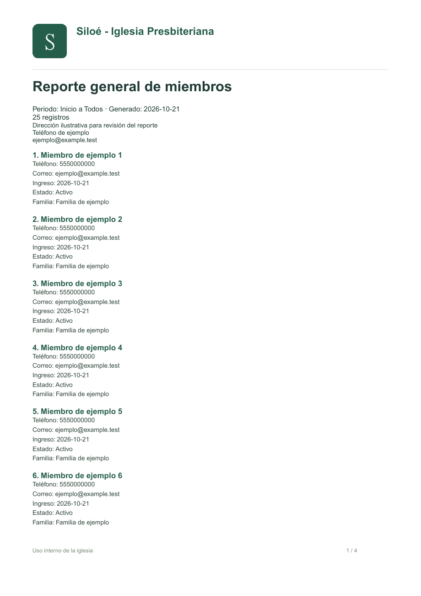

# Manual de uso · versión 2

## Inicio y acceso

Ejecutar iniciar.cmd o, en PowerShell desde la carpeta del proyecto, .\iniciar.cmd. Esperar la dirección que muestra el iniciador. Si 3000 está ocupado, abrirá otro puerto; no reutilizar una pestaña vieja. La primera instalación solicita administrador, correo y contraseña de 12 a 256 caracteres. Si está configurado SETUP_TOKEN, el formulario también lo solicita.

Las sesiones duran ocho horas. Cerrar con Salir. Desde Mi contraseña se puede cambiar la clave actual, confirmando la nueva; el cambio cierra todas las sesiones.

## Identidad de la iglesia

Con cuenta de administrador: Configuración. Capturar nombre, dirección, teléfono, correo y horarios. Subir logo PNG/JPG/WebP (hasta 500 KB) y portada (hasta 2 MB). Aparece una vista previa antes de guardar. Marcar Quitar para retirar una imagen. El servidor valida los archivos y los convierte a PNG, sin conservar metadatos originales.

El logo y el nombre se reflejan en la página de acceso, menú, cabecera, vista de reportes y PDF descargado. Excel incluye nombre y datos institucionales. La portada se usa en acceso y panel. Los horarios no crean eventos recurrentes.

## Miembros: registro rápido

1. Miembros → Registrar, o Registrar miembro desde el panel.
2. Escribir el nombre completo. Se utiliza la fecha de hoy si no indicas otra.
3. Abrir Teléfono, correo, familia y otros datos si deseas completarlos ahora.
4. Guardar o Guardar y agregar otro para continuar registrando.
5. Si se detecta el mismo nombre o correo, revisar el registro existente. Solo si es una persona distinta marcar la confirmación y guardar otra vez.

La búsqueda y filtro permiten encontrar miembros y separar activos/inactivos. Para una baja, editar y seleccionar Inactivo. Se conserva el historial. Familia/hogar permite agrupar por un texto compartido y buscarlo; no existe todavía un asistente que cree automáticamente a toda una familia.

## Importar desde Excel o CSV

Descargar plantilla en Miembros. La columna Nombre es obligatoria. Las demás son Teléfono, Correo, Fecha de ingreso, Estado y Familia. Mantener teléfonos como texto para conservar ceros iniciales. Fechas en AAAA-MM-DD o celdas de fecha de Excel. Solo se lee la primera hoja.

Seleccionar Importar Excel / CSV, cargar el archivo y pulsar Revisar archivo. Máximo 1000 filas y 2 MB. La vista previa muestra filas listas, duplicadas y con errores. Confirmar Importar N miembros. Las filas con errores o duplicados se omiten; ningún miembro existente se sobrescribe. La revisión vence a los 10 minutos y solo puede usarse una vez.

## Usuarios

Administrador: Usuarios → Registrar o Editar. Cambiar nombre, correo principal, correo de recuperación opcional, teléfono de recuperación opcional, rol y estado. En edición, dejar la contraseña vacía para conservarla o establecer una nueva de al menos 12 caracteres. Cambiar un rol, desactivar o restablecer la contraseña revoca las sesiones del usuario. No se permite dejar a la iglesia sin administrador activo. Las cuentas inactivas no pueden iniciar sesión.

## Recuperar contraseña

Olvidé mi contraseña → indicar el correo principal de la cuenta. El enlace se envía al correo de recuperación si está definido; de lo contrario al principal. Con SMTP configurado se recibe un enlace y código. El enlace abre el formulario de restablecimiento. El token vence a los 30 minutos y se utiliza una sola vez. Cambiar la clave invalida sesiones existentes. En desarrollo sin SMTP el código se muestra en la terminal; en producción no se imprime. Consultar Operación para configurar el correo real.

## Mis datos de recuperación

Al crear una cuenta, incluido el primer administrador, se puede añadir un correo alternativo y teléfono. No es obligatorio. Después, cada usuario abre **Recuperación** en la cabecera para ver o actualizar sus propios datos, confirmando su contraseña actual. El administrador también puede editarlos en Usuarios. Un campo vacío elimina el contacto alternativo.

Se valida el formato del correo y un teléfono de 7 a 15 dígitos, con prefijo de país opcional. Revisar que sean correctos y que se tenga acceso al buzón alternativo. Cambiar los datos invalida enlaces de recuperación emitidos previamente. El teléfono permite contacto de apoyo con el administrador: no envía códigos ni restablece la contraseña por sí solo. No se pide ni se almacena la contraseña del correo alternativo.

Elegir un destinatario de recuperación no configura el servidor que envía correos. Sigue siendo necesario SMTP o el servicio de envío de la iglesia.

## Eventos y ministerios

Crear eventos con título, fecha, hora, lugar, responsable y descripción. El ministerio es opcional. Editar para modificar o cambiar a Cancelado; no se borra el historial. Calendario mensual permite recorrer meses.

En Ministerios registrar nombre, coordinador, descripción e integrantes. Los eventos vinculados al ministerio aparecen bajo Actividades programadas. Puede haber miembros en varios ministerios. El coordinador de esta versión puede operar todos los ministerios.

## Asistencia

Primero registrar miembros y un evento activo. Elegir evento: se sugiere su fecha. Buscar miembros, marcar presentes o utilizar Marcar todos presentes/ausentes. La búsqueda no elimina miembros de la lista. Los no marcados quedan ausentes. Se muestra el total marcado. No se acepta una segunda lista para el mismo evento y fecha; editar la existente. Se puede corregir el historial de miembros posteriormente inactivos. No se crea asistencia nueva para eventos cancelados.

## Aportaciones

Solo administrador y tesorero. Registrar fecha, monto positivo con dos decimales, concepto y método (efectivo, transferencia, tarjeta u otro). Elegir miembro o Anónima. Moneda: MXN. El panel muestra ingresos del mes, y reportes permite obtener el total de cualquier periodo. No se registran gastos ni se emiten comprobantes fiscales en esta versión.

## Comunicados

Crear título, fecha y contenido. El panel muestra anuncios desde su fecha de publicación. Editar o eliminar; se pide confirmación antes de eliminar.

## Reportes

Elegir miembros, asistencia, ministerios o aportaciones según permisos. Filtrar Desde/Hasta, últimos siete días o mes actual. Para asistencia seleccionar evento; para participación seleccionar ministerio.

- Miembros: fecha de ingreso y datos de contacto/estado/familia.
- Asistencia: presentes, ausentes, porcentaje y nombres por evento/fecha.
- Ministerios: integrantes actuales, actividades del periodo, asistencias de integrantes en esas actividades y nombres.
- Aportaciones: detalle y total del periodo.

Descargar Excel genera .xlsx con encabezado institucional. Descargar PDF genera directamente un documento con logo y paginación. No requiere usar la impresión del navegador.

